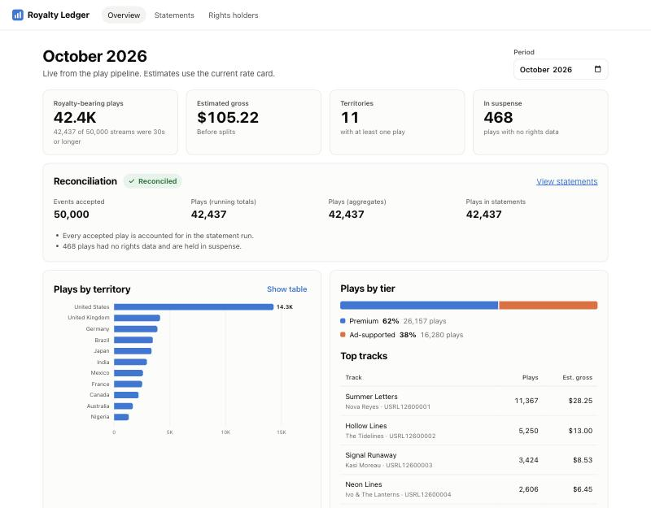
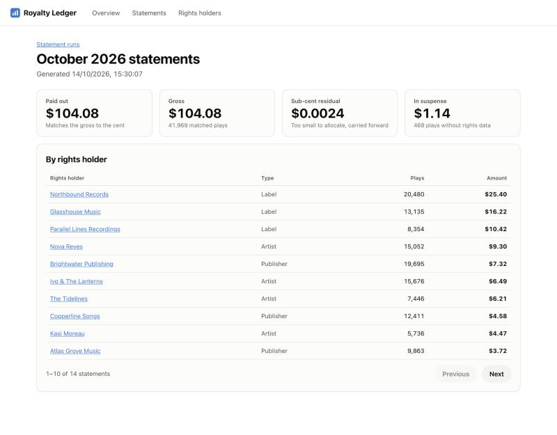
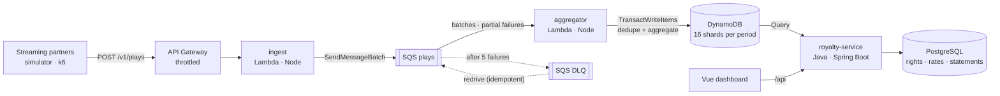

# Royalty Ledger

**An event-driven music royalty pipeline: ingest streaming plays at scale, count each one exactly once, and turn them into payouts that add up to the cent.**

[](https://github.com/opeoluwaAkinola/royalty-ledger/actions/workflows/ci.yml)

Streaming partners send play events. Royalty Ledger validates and queues them, aggregates them by track, territory and subscription tier, and once a month runs statements that pay labels, artists and publishers their share. Three independent counts are reconciled, so every play can be accounted for.

<p>
  
  
</p>

## Architecture



| Component | Stack | Responsibility |
|---|---|---|
| [`services/pipeline`](services/pipeline) | Node 22, AWS SDK v3, Zod, Vitest | **ingest** Lambda validates events row by row and batches them into SQS. **aggregator** Lambda counts them exactly once in DynamoDB. |
| [`services/royalty-service`](services/royalty-service) | Java 21, Spring Boot 4, JdbcClient, PostgreSQL, Flyway, AWS SDK v2, JUnit 5 | Rights data, rate cards, idempotent statement runs, the royalty calculator, reconciliation, and a REST API with OpenAPI docs. |
| [`web`](web) | Vue 3, TypeScript, Vite | Dashboard with live period summary, reconciliation status, statements drill-down, and accessible charts with table views. |
| [`tools/simulator`](tools/simulator) | Node | Realistic traffic: Zipf track popularity, weighted territories, 15% skips, unknown ISRCs, and deliberate duplicate retries. |
| [`load`](load) | k6 | Sustained-rate load test with latency and error SLOs as pass/fail thresholds. |
| [`infra/terraform`](infra/terraform) | Terraform (AWS) | DynamoDB (TTL, PITR), SQS and DLQ, both Lambdas, the event source mapping, HTTP API with IAM auth and throttling, alarms to SNS, ECR. Least-privilege IAM throughout. |
| CI | [GitHub Actions](.github/workflows/ci.yml) | Unit and integration tests (DynamoDB Local), Terraform validate, and a full **exactly-once end-to-end test** on Docker Compose. |

## Quick start

You need Docker and Node 20 or later.

```bash
docker compose up --build -d --wait   # AWS emulated with DynamoDB Local + ElasticMQ (SQS)
make simulate                         # 50,000 plays, 5% of batches re-sent as partner retries
```

Open **http://localhost:8088**. Then click **Run statements**, and drill into any rights holder to see each line item.

```bash
make e2e    # asserts exactly-once counting, reconciliation, and statements summing to the cent
make load   # k6: 4,000 events/s sustained for 60s
make test   # every unit and integration suite
```

| URL | |
|---|---|
| http://localhost:8088 | Dashboard |
| http://localhost:8085/swagger-ui/index.html | royalty-service OpenAPI |
| http://localhost:8090/v1/plays | Ingest API (POST) |

If a port is taken, override it, e.g. `POSTGRES_PORT=55432 docker compose up -d`.

## Results (measured locally)

Measured on a laptop running everything in Docker, with emulated AWS services. These numbers show the design holds under load. They are not cloud benchmarks.

| Test | Result |
|---|---|
| k6 ingest, 40 req/s x 100 events (**4,000 events/s**) for 60s | p95 **8.5 ms**, max 76 ms, **0 errors**, all thresholds passed |
| Simulator, 50,000 unique events + 2,500 duplicate retries | **exactly 50,000 counted** |
| Concurrent triple delivery of 400 events (DynamoDB Local test) | **exactly 400 counted** |
| 283,700 events from the k6 run, drained by 8 local consumers | totals = aggregates, **DLQ empty** |
| Statement run on 42,437 plays | 14 statements, **$104.08 paid = $104.08 gross**, $1.14 held in suspense |

## Design decisions

**Exactly-once counting on at-least-once delivery.** Each group of events is written in one DynamoDB transaction that both records the `eventId` (conditional put) and increments the aggregates. Duplicates cancel the transaction; the aggregator drops exactly the duplicate events (using `CancellationReasons`) and retries the rest. → [ADR 1](docs/adr/0001-exactly-once-counting-on-at-least-once-delivery.md)

**No hot partitions.** Each month is spread over 16 partition keys by FNV-1a hash, and reads fan out across all shards. → [ADR 2](docs/adr/0002-write-sharding.md)

**Money that adds up.** Integer micro-dollars and basis points, exact until the final step, then largest-remainder allocation. Statements always total `floor(gross)` to the cent, and every holder is within a cent of their exact share. This is verified by a property test on 200 random catalogs per build. → [ADR 3](docs/adr/0003-money-in-integers-and-largest-remainder.md)

**Three-way reconciliation.** The aggregator keeps independent sharded running totals. The royalty service compares them with the aggregate rows and with the statement run, reporting `MATCH`, `LATE_PLAYS` (arrived after the run, so they go into next period's adjustments) or `PIPELINE_DRIFT` (investigate).

**Failure isolation.** The ingest API rejects bad rows individually rather than failing the whole batch. The aggregator uses SQS partial batch responses, so one poisoned message is retried alone and eventually dead-lettered. CloudWatch alarms fire on DLQ depth, backlog age and Lambda errors, and `make redrive` replays the DLQ safely.

**Suspense, not silence.** Plays for recordings with no rights data are counted and valued but held in suspense, not dropped or misattributed.

**Accessible data viz.** Charts use a validated colorblind-safe palette, each chart has a table view, status is shown with an icon and a label (never color alone), and an axe-core test runs in CI.

## Tests

| Suite | Count | Highlights |
|---|---|---|
| pipeline | 15 | In-memory DynamoDB with real transaction semantics, plus concurrent duplicate delivery against DynamoDB Local |
| royalty-service | 212 | 200 randomized property runs of the money invariants, Flyway + MockMvc API tests |
| web | 6 | Behavior and axe-core accessibility tests |
| simulator | 3 | Distribution sanity checks |
| end-to-end | 5 checks | [`scripts/e2e.sh`](scripts/e2e.sh): exactly-once, reconciliation, cent-exact totals |

## Deploying to AWS

```bash
make lambda
cd infra/terraform && cp terraform.tfvars.example terraform.tfvars
terraform init && terraform apply
```

Partners then sign requests (SigV4) to `ingest_url`/v1/plays. Run royalty-service and web as containers (ECS or EKS) from the ECR repositories, attach `royalty_service_read_policy_arn` to the service's role, and subscribe to `alerts_topic_arn`.

## Roadmap

- Adjustments: carry `LATE_PLAYS` into the next period's statements automatically
- Kinesis Data Streams as an alternative ingest path for partners that stream continuously
- OpenTelemetry traces from ingest to statement line, exported to Datadog
- Disputes workflow: rights holders flag a line, and finance resolves it with an audit trail
- Multi-currency statements with FX rates locked per period

## License

MIT
